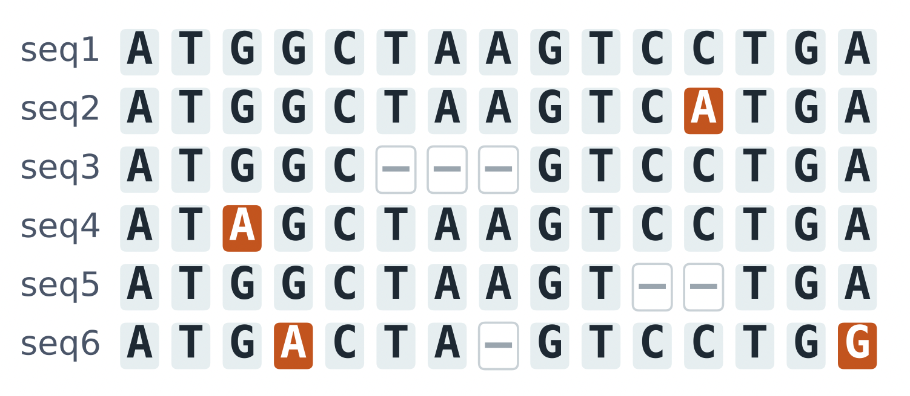
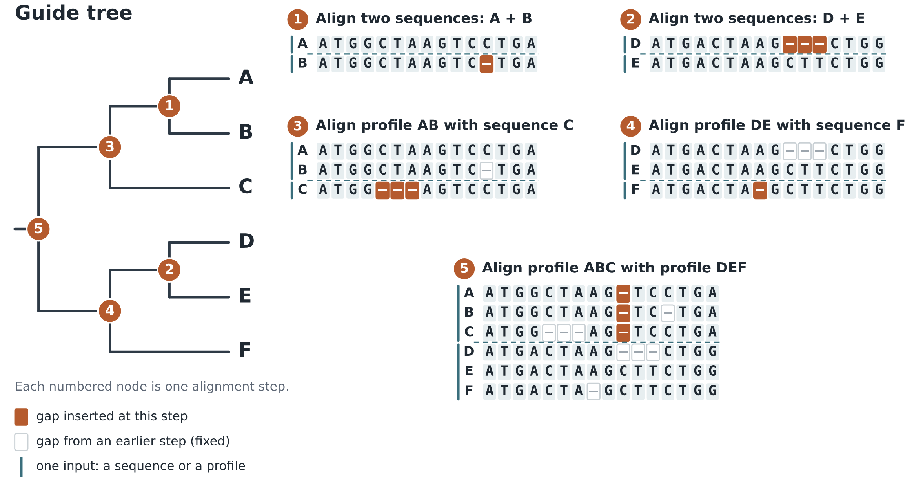
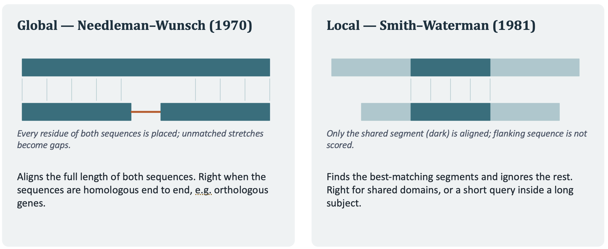
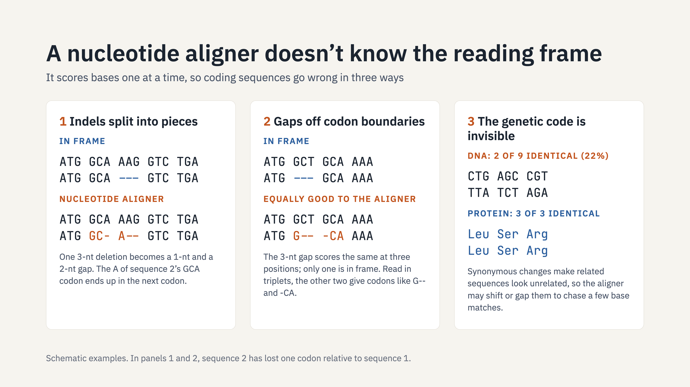

2026-10-16 class
===

Today we'll cover how to make a multiple sequence alignment.

# Context

You've made consensus sequences from your mapped FASTQ alignment (SAM
files) and you intend to make a phylogenetic tree. You've downloaded
some reference files from NCBI that you want to compare your
consensus(es) to.

What multiple sequence alignment does
===

Simplistically, MSA figures out a way to insert gaps into sequences to
make nucleotides or amino acids align column-wise as well as possible.



Once again, this is actually very complicated (assuming you try to do
a good job).

There are many programs to make an MSA
===

Some of the main ones:

* MAFFT
* MUSCLE 5
* Clustal Omega
* FAMSA2
* T-Coffee
* PRANK

Let's start by doing something
===

Today we'll play with `MAFFT`. This is probably the most-widely used
MSA tool.

It has 170 command-line options. Unfortunately (and inexplicably) the
description of these are spread over various web pages. It can be hard
to track them down or even to know they exist.

# Install MAFFT

```bash
$ pixi add mafft
```

And don't forget to activate the environment:

```bash
$ pixi shell
```

Some HBV data
===

I put 103 HBV genomes into `/sc-projects/sc-proj-cc11-civclub/club-club/data/hbv-genomes.fasta`.

You can probably get to this as `~/data/hbv-genomes.fasta` via the
symlink in your home directory.

# Try this

```bash
$ mkdir ~/msa-class
$ cd ~/msa-class
$ mafft ~/data/hbv-genomes.fasta > hbv-genomes-aligned.fasta
```

On a compute node with 32Gb of RAM this took under three seconds.

Options you could add

* `--out` - put the output into a given file (instead of standard output).
* `--preservecase` - keep sequences in the same case as the input file.
* `--anysymbol` - allow odd characters in sequences (treat them as `N`).
* `--thread` - use multiple threads to increase speed.
* `--reorder` - make the output order match the input order.
* `--quiet` - don't print progress information.

How MAFFT works
===

Three steps always run. Then there's an optional fourth.

* Compute pairwise distances.
* Use the distances to make a "guide tree".
* Make a progressive alignment (starting from tips) from the tree.
* Optional: iterative refinement.

MAFFT: Pairwise alignment
===

This is used to get distances between pairs of sequences to make a
guide tree. The "tree" is really just the result of distance-based
clustering.

Full pairwise alignment can be slow.

* Fast methods count shared 6-mers (by default) in each pair. This is
  cheap but still an O(N²) approach
* Much slower: run a full (dynamic-programming) alignment of every pair.
* PartTree picks a few representative sequences, assigns the other
  sequences to their nearest representative, and recurses inside each
  group, so it doesn't needs the full N × N matrix. This is O(N log N).

MAFFT: Guide tree
===

* Distances are clustered to make a rooted tree. This fixes the order
  in which sequences and groups are merged. Sequence weighting keeps
  many near-identical sequences from dominating.
* In FFT-NS-2 (the default), the first tree from k-mer distances is
  rough. MAFFT aligns using it, recomputes distances from that
  alignment, builds a better tree, and aligns again.
      
MAFFT: Progressive alignment
===

Working from the leaves of the tree to the root, MAFFT merges
sequences into groups and groups into larger groups. Each merge is a
group-to-group (profile) dynamic-programming alignment. A column
pair’s score is the weighted average of the substitution scores
between all residue pairs across the two groups.

This is where the FFT comes in. MAFFT doesn’t run dynamic programming
over the full length right away. It converts each residue into
numbers: for amino acids, their volume and polarity; for nucleotides,
one value per base. It then uses the fast Fourier transform to compute
the correlation between the two profiles at every possible
offset. Peaks in the correlation mark offsets at which homologous
segments line up. MAFFT locates those segments and runs dynamic
programming only between and around them, which is much cheaper for
long sequences. --nofft (the NW-NS methods) skips this shortcut and
uses plain dynamic programming throughout.

Like every progressive method, this one has a weakness: gaps placed in
early merges are fixed for the rest of the run.



MAFFT: Optional iterative refinement
===

Refinement goes back to correct early mistakes. MAFFT repeatedly cuts
one branch of the guide tree, which splits the alignment into two
sub-alignments. It removes columns that are entirely gaps, realigns
the two parts against each other, and keeps the new alignment only if
the objective score improves. It cycles through the branches until
nothing improves or `--maxiterate` is reached.

MAFFT: other useful options
===

Options for adding new sequences to an existing alignment instead of
realigning everything:

* `--add`
* `--addfragments`
* `--addprofile`
* `--addlong`

Maintaining the length of a pre-existing alignment:

* `--keeplength`

Letting MAFFT to decide which approach to take:

* `--auto`

MAFFT: How `--auto` works
===

You can run with `--auto` if you want MAFFT to decide which approach
to take. `--auto` measures the number of sequences and their length
then takes the first rule that applies:

* < 100 sequences and length < 3,000: L-INS-i
* < 200 sequences and length < 1,000: L-INS-i with 2 iterations
* < 500 sequences and length < 10,000: FFT-NS-i, 2 iterations
* < 20,000 sequences: FFT-NS-2
* < 100,000 sequences: FFT-NS-2 with a memory-saving tree
* < 200,000 sequences: FFT-NS-1 with a memory-saving tree
* Else: PartTree variants

Taking a step back
===

# Pairwise sequence alignment

* Is a solved problem.
* Can be done on full sequences or locally
* There are well-known algorithms for both



# Amino acid alignments

Many packages can make protein alignments. This can be much better /
more appropriate in some circumstances.

# Codon-aware alignments

Codon alignments
===



Upcoming classes
===

* Tree making.
* The dark-matter tools.
* _de novo_ assembly.
* Protein-level matching.

<!--
Local Variables:
indent-tabs-mode: nil
End:
-->
