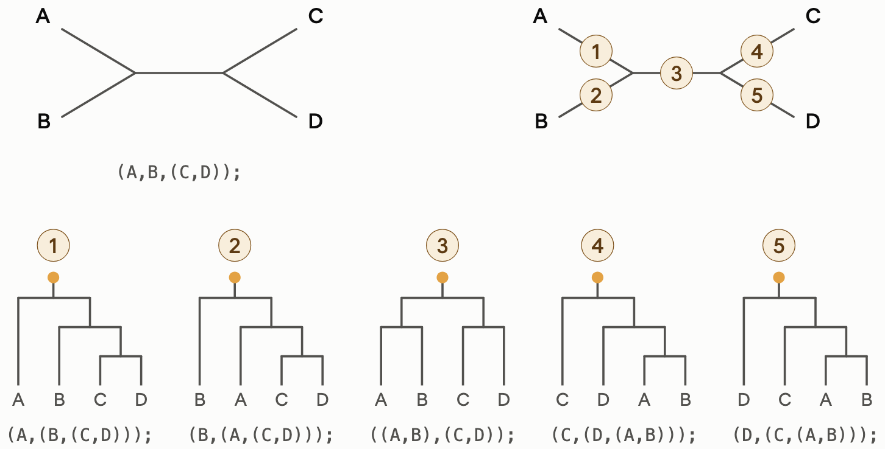
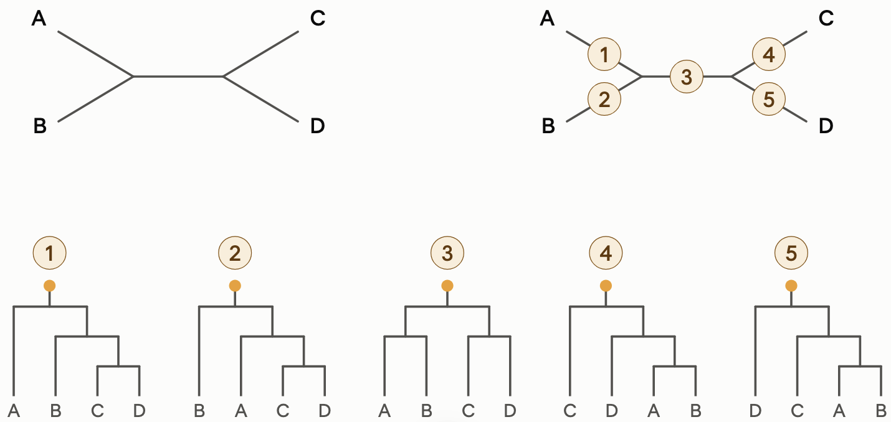

2026-10-23 class
===

Today we'll look at making phylogenetic trees (with `iqtree`).

# Context

* You've mapped your FASTQ (e.g., `bowtie2`) to a reference (to get a SAM file).
* You've called a consensus sequence from your SAM file (e.g., `iVar`).
* You've downloaded some references to compare your consensus to (e.g., NCBI `datasets`).
* You made a multiple sequence alignment (e.g., `MAFFT`).

Now you want to make a phylogenetic tree.

# It's _very_ complicated!

This is another complicated subject - the most complicated of all in
this course.

I'm not qualified to teach this subject!
===

Today I will only cover a few basic things.

* Basic use of `iqtree3`.
* Unrooted versus rooted trees.
* Rooting.
* Newick format.
* Basic bootstrapping and support values.
* Polytomies.

# Things I will not cover

* Model selection.
* How to choose a root.
* BEAST trees.
* Making tree images.

And any number of other things!

Let's start by using iqtree
===

Make a tree from 10 of the HBV sequences from last week.

# Try to figure it out yourselves

You'll need to

* Make an alignment (use `mafft` on `~/data/hbv-genomes-10.fasta`).
* Install `iqtree`.
* Figure out how to run `iqtree`.
* Do it on a compute node (I used 32Gb of RAM and 4 cores).

# Note

`RAxML-ng` is also another good tree-making package. See
https://codeberg.org/amkozlov/raxml-ng/wiki

Install iqtree
===

```sh
$ pixi add iqtree

$ iqtree --version
IQ-TREE version 3.1.4 for Linux x86 64-bit built Sep 29 2026
Developed by Bui Quang Minh, Thomas Wong, Nhan Ly-Trong, Huaiyan Ren
Contributed by Lam-Tung Nguyen, Dominik Schrempf, Chris Bielow,
Olga Chernomor, Michael Woodhams, Diep Thi Hoang, Heiko Schmidt
```

OK, I'll do it
===

This is just 10 sequences, so it's very fast:

```sh
$ srun --pty --mem 32G --cpus-per-task 4 --time 2:00:00 bash -i
$ pixi shell
$ mafft --auto ~/data/hbv-genomes-10.fasta > hbv-genomes-10-aln.fasta
$ iqtree -T 4 -s hbv-genomes-10-aln.fasta --prefix out
```

On the compute node this takes under a second for `mafft` and about
five seconds for `iqtree`.

Here's the result (and you can see why I used `--prefix out`):

```sh
$ ls -l out.*
-rw-r--r-- 1 jonestc posix-nogroup   308 Oct 23 00:50 out.bionj
-rw-r--r-- 1 jonestc posix-nogroup   805 Oct 23 00:50 out.ckp.gz
-rw-r--r-- 1 jonestc posix-nogroup 22699 Oct 23 00:50 out.iqtree
-rw-r--r-- 1 jonestc posix-nogroup  6334 Oct 23 00:50 out.log
-rw-r--r-- 1 jonestc posix-nogroup  1123 Oct 23 00:50 out.mldist
-rw-r--r-- 1 jonestc posix-nogroup  3795 Oct 23 00:50 out.model.gz
-rw-r--r-- 1 jonestc posix-nogroup   328 Oct 23 00:50 out.treefile
```

`out.treefile` contains the final tree (more on that in a minute).

Newick format
===

Tree-making software normally produces trees in Newick
format. (Another widely used format is NEXUS.)

“The wonderful thing about standards is that there are so many of them
to choose from.” (Grace Hopper? Andrew Tanenbaum?)



See https://en.wikipedia.org/wiki/Newick_format

If you followed the steps above, iqtree has put your final (best) tree
into a file ending in `.treefile`. Mine is in `out.treefile`. Have a look:

```
(AB076679:0.0251090101,(AB116084:0.0158252100,AB453988:0.0095428844)
:0.0055019214,((AY738142:0.0303059664,GQ331046:0.0270531281):0.0049954598,
((AY934764:0.0034802239,GQ161813:0.0032690208):0.0158727834,(FJ692556
:0.0132301128,(FJ692598:0.0051383712,FJ692611:0.0086008373):0.0055463444)
:0.0058514071):0.0038079824):0.0107358508);
```

Unrooted versus rooted
===

Tree-making packages make unrooted trees!

In an unrooted tree, all non-tip nodes have three branches connecting them.



When you root the tree, you choose a branch and introduce a new node
onto that branch. That node then has two branches leaving it.

# How do you root?

Most people would do it by loading the Newick tree into some kind of
viewer, selecting a branch, then click on Root, then save the file.

Comments on rooting
===

Obvious issues raised by rooting

* How do you choose where to put the root?
* Once you choose a branch, where exactly do you put the new node
(i.e., how long should the nodes children be?)

# Notes

The root node has just two branches leaving it.

Sometimes an imaginary branch leaving the root but leading nowhere is
added _for visual purposes_. That branch, if shown, is not part of the
tree. I.e., it doesn't have a length and it's not in the Newick file.

If you re-root an already rooted tree, the originally inserted root
node is removed.

# How can you tell (looking at Newick) if a tree is rooted?

If a tree is unrooted, the first node that appears in the Newick file
can be any of the (internal) nodes in the tree, and **it will have
three children**!

If the tree is rooted, the first node will be the root and **it will
have two children**.

How do you know if your tree topology is reliable?
===

The most common way to get an idea is to use "bootstrapping" to derive
"support" values for the _branches_ of your best tree.

In the simplest form of bootstrapping, columns are randomly selected
(with replacement) from the alignment to make a new alignment from
which a tree is made.

Your tree is checked against the new tree by checking each branch to
see whether, if the branch was removed, the sets of nodes in the
resulting pieces are the same in the two trees. If so, the new tree
"supports" the topology of your best tree. This is done 100 or 1000
times and the support value for the branch is the percentage of times
the two tip sets left on each side of the trees are the same.

There are many methods of calculating support, and different methods
have different (informally) acceptable thresholds for when you can
have confidence that a clade is isn't just a fluke.

# Try this

```sh
$ iqtree -B 1000 -redo -T 4 -s hbv-genomes-10-aln.fasta --prefix out
```

Then let's have a look at `out.treefile`.

```
(AB076679:0.0251090108,(AB116084:0.0158252108,AB453988:0.0095428842)98:0.0055019,
((AY738142:0.0303059668,GQ331046:0.0270531285)91:0.0049954607,
((AY934764:0.0034802237,GQ161813:0.0032690208)100:0.0158727835,
(FJ692556:0.0132301127,(FJ692598:0.0051383710,FJ692611:0.0086008369)100:0.005546)
100:0.0058514068)95:0.0038079827)100:0.0107358505);
```

Viewing trees
===

# Some online tools

These allow you to upload your own Newick file:

* Interactive Tree of Life: https://itol.embl.de/
* ETE toolkit: https://etetoolkit.org/treeview/
* phylo.io: for visualising and comparing phylogenetic trees side by side https://phylo.io
* reactree: https://phylogeny.fr/tools/reactree

# Apps you can install

* Figtree
* Dendroscope

# What about metadata and annotations?

Other than tip names and support values, additional information is
typically not in a Newick file. NEXUS files sometimes have other
information, like colour.

So additional information, like internal node names, icons, colours,
needs to be stored elsewhere.

Non-programmers will typically just use a graphical tool like Inkscape
to in a sense "store" this extra information with the tree.

This is fairly simple but it's a very bad approach, because you'll
very likely have to make the tree many times. Maybe hundreds of times
during a research project.

So, produce your tree images with code instead. E.g., check out ete
https://github.com/etetoolkit/ete and some code examples at
https://etetoolkit.github.io/ete/tutorial/tutorial_treeview.html

Caution: there are many underlying assumptions
===

When deciding to make a tree, you're assuming various things are (more
or less) true.

Here are the categories of assumptions that Claude lists.

* That the evolutionary history of your sequences is a tree. You'll _always_ get a tree.
* That columns in your alignment are homologous.
* That the substitution process has a particular form.
* Inference-method specific assumptions.
* Assumptions added when the tree is interpreted.

Each of these has at least several sub-points, and some have many.

Deviations from the assumptions may have major or only minor
consequences.

Further reading
===

_Decoding Genomes_ (2024) seems good (maybe very good). But it likely
has too much mathematics for most people (including me). But you can
read the introductory chapters. There's a free download at
https://decodinggenomes.org


Upcoming classes
===

* The dark-matter tools.
* _de novo_ assembly.
* Protein-level matching.

<!--
Local Variables:
indent-tabs-mode: nil
End:
-->
