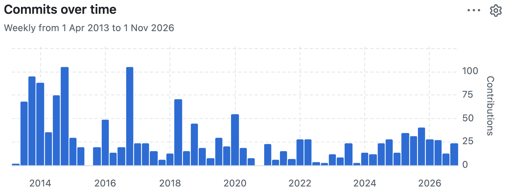
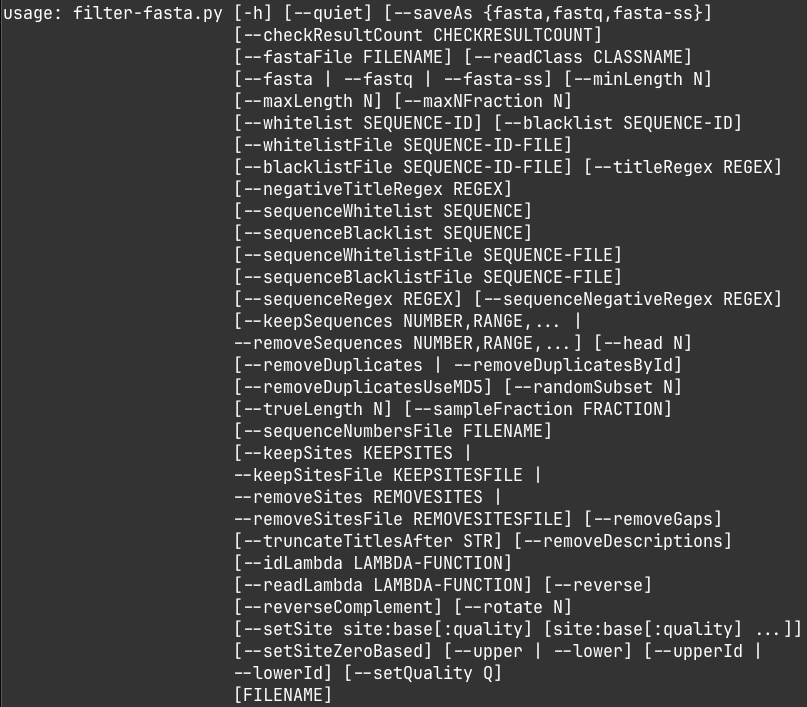
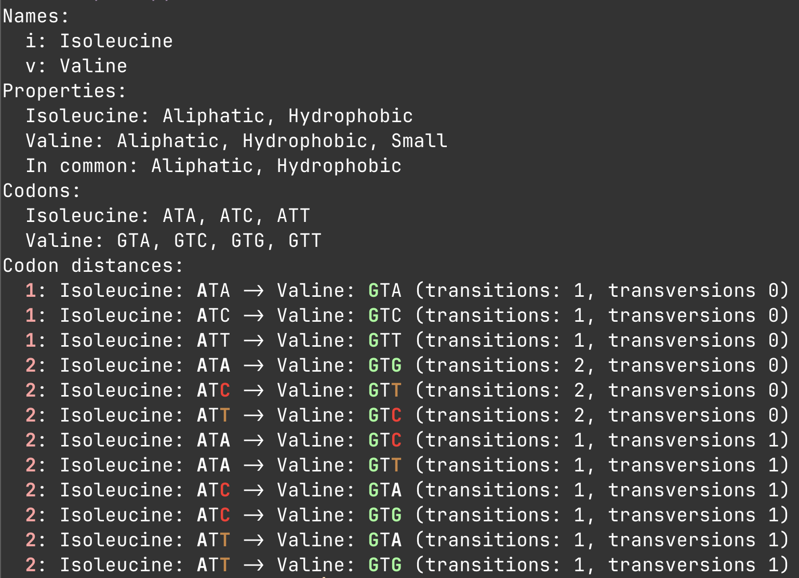
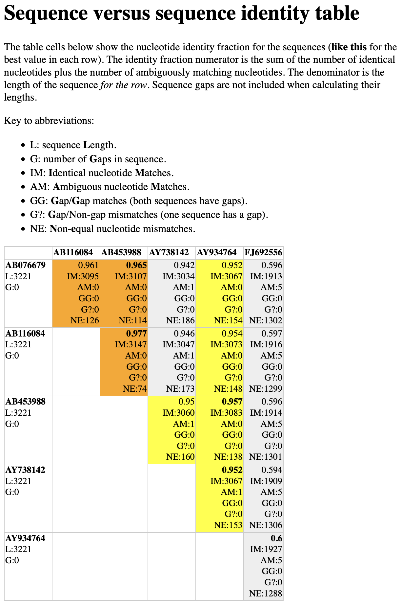
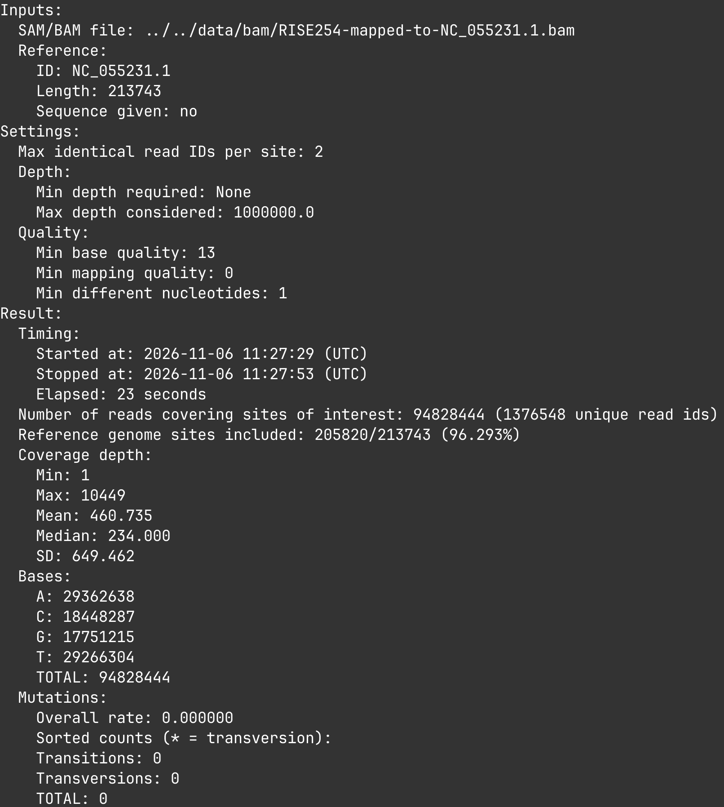

2026-11-05 class
===

Today I'll give an introduction to the `dark-matter` scripts

# WTF is dark-matter?

A suite of Python scripts (and library functions) for bioinformatics
work.

You don't need to be a Python programmer to use the scripts. But you
need Python installed.

# Stats

`dark-matter` was written over the last 13 years (first commit 27.06.2013).

It provides 108 scripts, and has 87,267 lines of code and 2,627 tests.




Installing dark-matter
===

```sh
$ pixi add dark-matter
# Or 'pixi upgrade dark-matter' if you already have it installed.

$ pixi shell

$ dark-matter-version.py
7.5.8
```

You can find the Python source on GitHub at
https://github.com/acorg/dark-matter


dark-matter is famously undocumented!
===

Or it was until now.

I got Claude to help with a basic categorization and description of all
the scripts.  So there is now a fairly minimal (but at least accurate)
main README at https://acorg.github.io/dark-matter/

Click on the `Scripts` link on the left to see a listing of the
available scripts. Each script (that supports `--help`) can be clicked
on to see its `--help` output.

Or go to https://github.com/acorg/dark-matter/ and in the `doc` directory
you'll see a link to `scripts.md`.

Today we'll look briefly at 15 scripts
===

# Of high utility & will be used quite a bit today

* filter-fasta.py

# Simple utilities

* aa-compare.py
* aa-info.py
* fasta-count-chars.py
* fasta-count.py
* fasta-ids.py
* fasta-lengths.py

# More FASTA tools

* compare-sequences.py
* fasta-identity-table.py

# Command runners

* make-consensus.py
* run-bowtie2.py

# Tree tools

* curate-tree-ete.py
* tree-info.py

# SAM/BAM files

* sam-coverage-depth.py
* sam-reference-read-counts.py


filter-fasta.py
===

Provides _many_ ways to filter FASTA.

```bash
$ filter-fasta.py --help
```



aa-compare.py
===

```bash
$ aa-compare.py i v
```



aa-info.py
===

Print information about amino acids, based on names or codons.

```bash
$ aa-info.py k
Lysine
  3-letter abbreviation: Lys
  1-letter abbreviation: K
  Codons: AAA, AAG
  Properties: Basic positive, Hydrophobic, Polar
  
$ aa-info.py ggt
Glycine
  3-letter abbreviation: Gly
  1-letter abbreviation: G
  Codons: GGA, GGC, GGG, GGT
  Properties: Hydrophilic, Small, Tiny

$ aa-info.py leuc
Isoleucine
  3-letter abbreviation: Ile
  1-letter abbreviation: I
  Codons: ATA, ATC, ATT
  Properties: Aliphatic, Hydrophobic
Leucine
  3-letter abbreviation: Leu
  1-letter abbreviation: L
  Codons: CTA, CTC, CTG, CTT, TTA, TTG
  Properties: Aliphatic, Hydrophobic
```

fasta-count-chars.py
===

Print a summary of the characters in the sequences in FASTA input.

```bash
$ filter-fasta.py --quiet --head 1 ~/data/hbv-genomes.fasta | 
    fasta-count-chars.py --omitZeroes

ID              Char    Count   Length  Fraction
AB076679        A       736     3221    0.2285
AB076679        C       859     3221    0.2667
AB076679        G       702     3221    0.2179
AB076679        T       924     3221    0.2869
```

fasta-count.py
===

Count the number of sequences in FASTA input.

fasta-ids.py
===

Print the sequence IDs from FASTA input.

```bash
$ fasta-ids.py ~/data/hbv-genomes.fasta | head
AB076679
AB116084
AB453988
AY738142
AY934764
FJ692556
FJ692598
FJ692611
GQ161813
GQ331046
```

fasta-lengths.py
===

Print the sequence IDs and lengths from FASTA input.

```bash
$ fasta-lengths.py ../data/hbv-genomes.fasta | tail
AB059660 3215
AB375163 3215
AY090454 3215
AY090457 3215
AB562463 3215
EU835241 3215
FJ023669 3215
AB486012 3182
AF193863 3182
EU155824 3182
```

compare-sequences.py
===

Print a detailed comparison of two sequences:

```bash
$ compare-sequences.py ~/data/hbv-genomes.fasta
Sequence lengths are identical: 3221
Exact matches: 3095/3221 (96.09%)
Ambiguous matches (including Ns): 0
Mismatches: 126/3221 (3.91%)
  Not involving gaps (i.e., conflicts): 126/3221 (3.91%)
  Involving a gap in one sequence: 0
  Involving a gap in both sequences: 0
  Involving no coverage in one sequence: 0
  Involving no coverage in both sequences: 0
  Id: AB076679
    Length: 3221
    Gaps: 0
    No coverage: 0
    Ns: 0
    Ambiguous: 0
    Coverage (excluding Ns and alignment gaps): 3221/3221 (100.00%)
  Id: AB116084
    Length: 3221
    Gaps: 0
    No coverage: 0
    Ns: 0
    Ambiguous: 0
    Coverage (excluding Ns and alignment gaps): 3221/3221 (100.00%)
```

By default it uses the first two sequences in its input (but see
`--index1` and `--index2`).

You can tell it to align first with `--align` and which aligner to use
with `--aligner` (use "edlib" or "mafft" or "needle").

There are many options.

fasta-identity-table.py
===

Make an HTML table showing the identity between sequences in FASTA
input.

```bash
$ filter-fasta.py --quiet --head 6 data/hbv-genomes.fasta | 
    fasta-identity-table.py --showGaps --upperOnly --defaultColor '#eee' \
    --showLengths --color ".95 yellow" --color ".96 orange" --highlightBest \
    --concise > table.html
# Then open table.html in your browser.
```



make-consensus.py
===

A convenience script that either calls `iVar` or `bcftools` to make a
consensus sequence:

```bash
$ make-consensus.py --dryRun --bam NC_055231.1.bam --reference C_055231.1
$ samtools index 'NC_055231.1.bam'
$ bcftools mpileup --max-depth 5000 -a AD,DP -q 20 -Q 20 -f 'C_055231.1' 'NC_055231.1.bam' | bcftools call --ploidy 1 -mv -Oz -o '/tmp/x/vcf.gz'
$ bcftools index '/tmp/x/vcf.gz'
$ bcftools filter -e 'QUAL<20 || FORMAT/DP<1' '/tmp/x/vcf.gz' -Oz -o '/tmp/x/filtered-vcf.gz'
$ mv '/tmp/x/filtered-vcf.gz' '/tmp/x/vcf.gz'
$ bcftools index -f '/tmp/x/vcf.gz'
$ samtools depth -a 'NC_055231.1.bam' | awk '$3<1 {printf "%s\t%d\t%d\n", $1, $2 - 1, $2}' | sort -k1,1 -k2,2n > '/tmp/x/low-coverage.bed'
$ bedtools merge -i '/tmp/x/low-coverage.bed' > '/tmp/x/low-coverage-merged.bed'
$ bcftools consensus --samples 'SAMPLE-NAME' -m '/tmp/x/low-coverage-merged.bed' --fasta-ref 'C_055231.1' '/tmp/x/vcf.gz' --output '/tmp/x/consensus.fasta'

$ make-consensus.py --dryRun --bam NC_055231.1.bam --reference C_055231.1 --ivar
$ samtools index 'NC_055231.1.bam'
$ samtools mpileup -d 0 -aa -A -B -Q 0 --fasta-ref 'C_055231.1' 'NC_055231.1.bam' | ivar consensus -p '/tmp/x/temporary-consensus' -q 20 -t 0.6 -m 1
$ mv '/tmp/x/temporary-consensus.fa' '/tmp/x/consensus.fasta'
```

run-bowtie2.py
===

A convenience script that runs `bowtie2`:

```bash
$ bowtie2-build HBV-G.fasta hbv-db

$ run-bowtie2.py --index hbv-db --fastq1 HBV.fastq.gz --dryRun
$ bowtie2 --no-unal --threads 12 --rg-id 'orig' --rg 'SM:orig' -x 'hbv-db' -U 'HBV.fastq.gz' > '/tmp/x/result.sam'
$ samtools sort --output-fmt SAM '/tmp/x/result.sam' > '/tmp/x/result-sorted.sam'
$ mv '/tmp/x/result-sorted.sam' '/tmp/x/result.sam'
$ samtools view -b '/tmp/x/result.sam' > '/tmp/x/result.bam'
$ samtools index '/tmp/x/result.bam'
$ rm -r '/tmp/x/'
```

curate-tree-ete.py
===

```bash
$ cat tree.nwk
(A,(B,(C,D)));

$ newick-to-ascii.py --treeFile tree.nwk
  ╭╴name=A
──┤
  │  ╭╴name=B
  ╰──┤
     │  ╭╴name=C
     ╰──┤
        ╰╴name=D

$ curate-tree-ete.py --rootNode C tree.nwk | newick-to-ascii.py
  ╭╴name=C
──┤
  │  ╭╴name=D
  ╰──┤
     │  ╭╴name=B
     ╰──┤
        ╰╴name=A
        
$ cat tree-with-lengths.nwk
(A:1,(B:2,(C:1,D:1):4));

$ curate-tree-ete.py --rootNode C --format 1 tree-with-lengths.nwk | newick-to-ascii.py
  ╭╴name=C,dist=0.5
──┤
  │          ╭╴name=D,dist=1.0
  ╰╴dist=0.5╶┤
             │          ╭╴name=B,dist=2.0
             ╰╴dist=4.0╶┤
                        ╰╴name=A,dist=1.0
```


tree-info.py
===

```bash
tree-info.py tree-with-lengths.nwk
 0: Int NO-LABEL!  (root has 2 children)
   1: Tip A
   1: Int NO-LABEL!
     2: Tip B
     2: Int NO-LABEL!
       3: Tip C
       3: Tip D
The tree has 7 nodes (3 internal, 4 tips).
```

sam-coverage-depth.py
===

```bash
$ sam-coverage-depth.py RISE254-mapped-to-NC_055231.1.bam
...
213738 1300 A:0 C:0 G:1300 T:0
213739 1005 A:0 C:0 G:1005 T:0
213740 998 A:998 C:0 G:0 T:0
213741 992 A:0 C:1 G:991 T:0
213742 993 A:0 C:0 G:0 T:993
213743 986 A:0 C:986 G:0 T:0
```



sam-reference-read-counts.py
===

Show details of the matches against the references in a SAM/BAM file.

```bash
$ sam-reference-read-counts.py RS1444-Abatino-CPXV-ECTV-all-matches.bam
```

```
Found a total of 1440 reads (1440 mapped, 0 unmapped) mapping against 3 of 3 references.

Reference 1: NC_055231.1 (213743 nt):
  Genome coverage: 9.38%
  Overall reads mapped to the reference: 1394/1440 (96.806%)
    Non-duplicates: 1208/1394 (86.657%), Duplicates: 186/1394 (13.343%), QC fails: 0/1394 (0.000%)
    Primary: 774/1394 (55.524%), Secondary: 762/1394 (54.663%), Supplementary: 0/1394 (0.000%)
    Reads not matching any reference above: 1394/1440 (96.806%)
  Previously unmatched reads for this reference: 1394/1394 (100.000%)

Reference 2: NC_003663.2 (224499 nt):
  Genome coverage: 10.34%
  Overall reads mapped to the reference: 1181/1440 (82.014%)
    Non-duplicates: 975/1181 (82.557%), Duplicates: 206/1181 (17.443%), QC fails: 0/1181 (0.000%)
    Primary: 272/1181 (23.031%), Secondary: 1006/1181 (85.182%), Supplementary: 0/1181 (0.000%)
    Reads not matching any reference above: 44/1440 (3.056%)
  Previously unmatched reads for this reference: 44/1181 (3.726%)

Reference 3: NC_004105.1 (209771 nt):
  Genome coverage: 9.26%
  Overall reads mapped to the reference: 888/1440 (61.667%)
    Non-duplicates: 786/888 (88.514%), Duplicates: 102/888 (11.486%), QC fails: 0/888 (0.000%)
    Primary: 394/888 (44.369%), Secondary: 569/888 (64.077%), Supplementary: 0/888 (0.000%)
    Reads not matching any reference above: 2/1440 (0.139%)
  Previously unmatched reads for this reference: 2/888 (0.225%)
```

Upcoming classes
===

* _de novo_ assembly.
* Protein-level matching.

<!--
Local Variables:
indent-tabs-mode: nil
End:
-->
