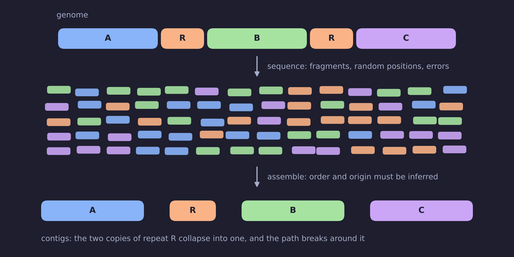
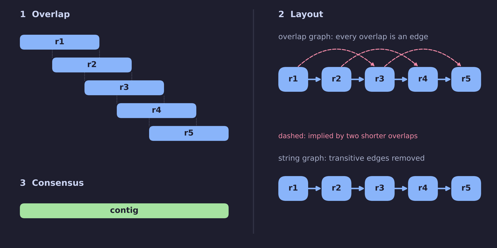
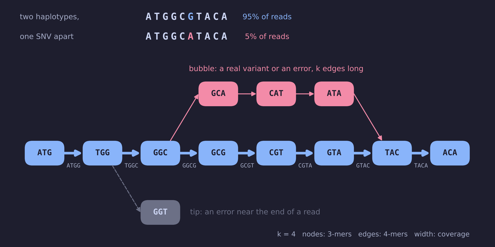
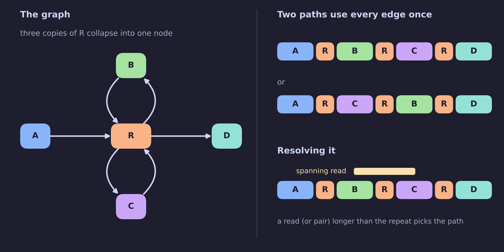
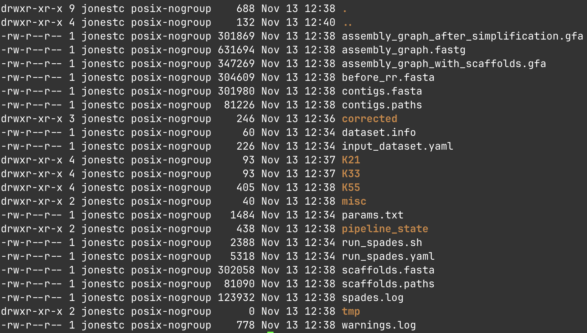
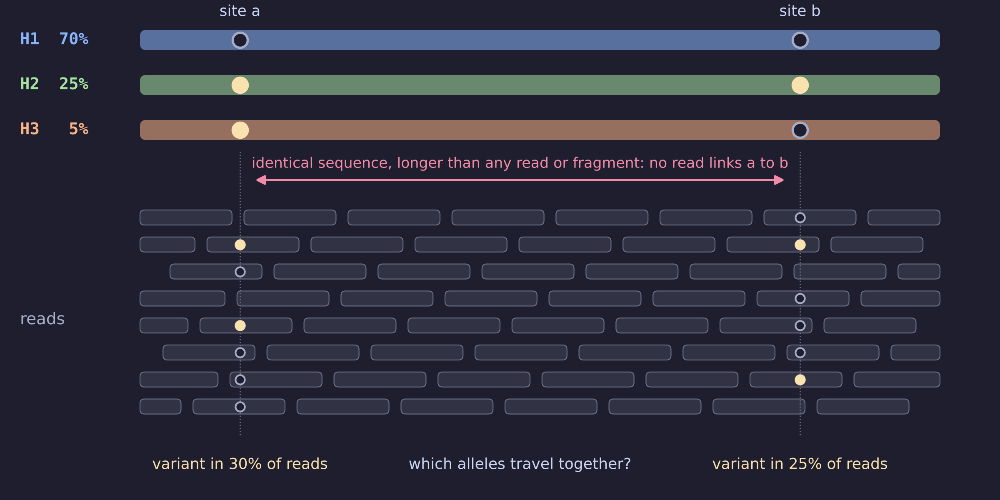
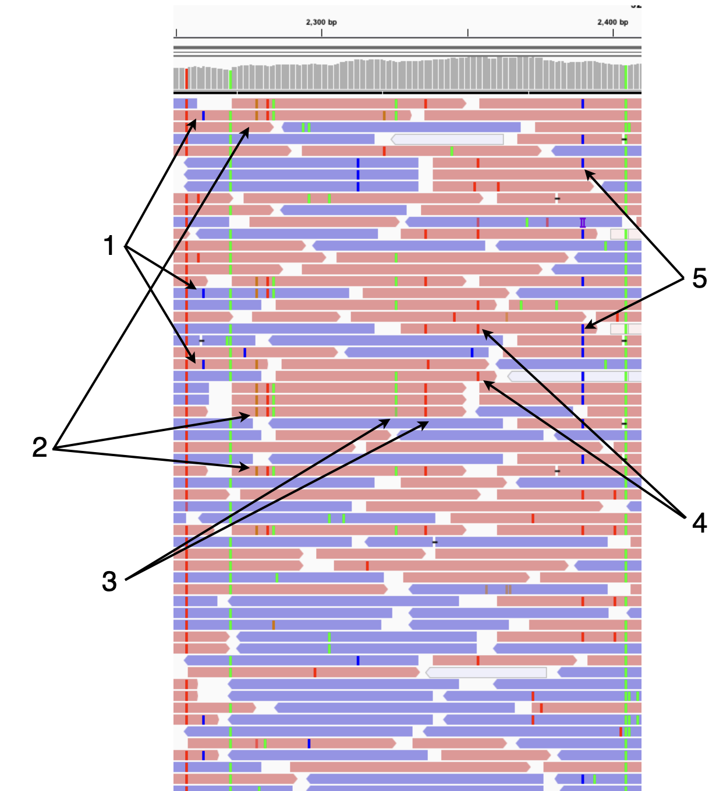

2026-11-13 class
===

Today we'll cover _de novo_ assembly.

As usual, this is a complicated subject with many packages available.

As usual, in preparing slides for the "class" I realized how little I know.

Why do we need to assemble?
===

We first break DNA molecules into pieces because the physical
sequencing methods have historically only worked on DNA fragments with
a small number of nucleotides (up to a few hundred).  This is slowly
changing, with long-read sequencing.  So we try to figure out a genome
sequence from its fragments, without a reference sequence.



Note that there is also
reference-guided assembly (which we won't discuss today).

# When/why would you use _de novo_ assembly?

It is quite contentious whether to use _de novo_ assembly at all.

At a metagenomics conference in Cambridge (about 12 years ago), a
strongly expressed opinion was that you should avoid _de novo_
assembly because it takes too long and is too error prone.

But if you have no reference to begin with, perhaps because your
sample has something unknown or very distant from known viruses, you
don't have much choice (at the nucleotide level).

What makes _de novo_ assembly hard?
===

# It's like doing a fiendishly difficult jigsaw

* The jigsaw puzzle box contains tens of millions of pieces.
* The pieces are from multiple pictures, none of which you get to see.
* Many of the pictures are almost identical.
* The picture you're aiming to reconstruct might be vanishingly small.
* And it might be unlike anything you've ever seen before.
* Many puzzle pieces are missing, duplicated, and damaged.
* Puzzle pieces can fit perfectly in multiple places in a single
  picture and fit perfectly in multiple pictures.

# How Claude describes the difficulties

* **Repeat**: sections of genomes that are longer than the read length.
* **Errors**: in reads may result in assembled sequences that are incorrect.
* **Coverage**: is uneven, so depth is a noisy signal (for copy number).
* **Diversity**: (multiple infections, strains, quasispecies).
* **Scale**: is quadratic if an algorithm compares every read with every other.
* **Host background**: most reads in a clinical sample are not viral.

Three classical approaches to _de novo_
===

I asked Claude: "What are the main approaches to de novo assembly?" 
It gave three categories (and listed 23 example packages!)

# Greedy extension

Repeatedly merge the reads or contigs with the best overlap (`phrap`,
`CAP3`, `TIGR`, `SSAKE`, and `VCAKE`). It makes locally optimal
choices with no global view, so repeats cause misjoins. This is
largely historical, but survives in some seed-and-extend tools.

# Overlap–layout–consensus

Compute all pairwise read overlaps, build a graph with reads as nodes
and overlaps as edges, find a layout through it, then call a consensus
(`Celera Assembler`, `Newbler`, `Arachne`, `Canu`). The string graph
refinement is used by `SGA`, `miniasm`, `FALCON`, and `hifiasm`.

# De Bruijn graphs

But first: what is a "graph"?

Break reads into k-mers, with (k−1)-mers as nodes and k-mers as edges,
so overlaps are implicit in shared k-mers and never computed
(`Velvet`, `ABySS`, `SOAPdenovo`, `SPAdes`, `MEGAHIT`). Graph size
scales with genome size, not read count. The price is sensitivity to
errors, since each error creates up to k spurious k-mers, and repeats
longer than k tangle the graph.

Hybrids apply de Bruijn-like ideas to noisy or long reads: `Flye`,
`wtdbg2`, `LJA`, `rust-mdbg`, `Verkko`.

Overlap-layout-consensus
===



* Overlap all reads via pairwise comparison. Done naively, this is O(n²) comparisons.
* The overlaps define a graph.
* Walk unambiguous sections of the graph and call a consensus.

# String graphs

A refinement of the overlap graph (Myers, 2005).

* Drop reads contained in other reads.
* Remove **transitive** edges: if r1 overlaps r2 & r2 overlaps r3, remove the r1 to r3 edge.
* What remains: unique stretches become simple paths, repeats become shared paths.

De Bruijn graphs
===



* Nodes are (k-1)-mers, edges are k-mers; overlaps are never computed
* A single difference creates k new edges: a **bubble** mid-read, a **tip** near an end


Repeated regions can be a show-stopper
===



Summary of the three approaches
===

| | Greedy | Overlap-layout-consensus | De Bruijn graph |
|---|---|---|---|
| Unit | read | read | k-mer |
| Overlaps | best first | all pairs, explicit | implicit in shared k-mers |
| Graph grows with | n/a | reads x coverage | genome size (plus error k-mers) |
| Suits | small, simple genomes | fewer, longer reads | many short, accurate reads |
| Weakness | misjoins at repeats | overlap computation | errors, repeats longer than k |
| Examples | phrap, CAP3, SSAKE | Celera, Newbler, Canu | Velvet, ABySS, SPAdes, MEGAHIT |

It often feels like everyone uses SPAdes!
===

https://ablab.github.io/spades/

Installing SPAdes
===

You can't do this via Pixi. You need to either download a pre-built
binary or download the source code and build it yourself. The former
is much easier (and, some would argue, also riskier).

Their GitHub page https://github.com/ablab/spades has a pointer to the
Download page https://github.com/ablab/spades/releases/latest/

On Linux:

```sh
$ wget https://github.com/ablab/spades/releases/download/v4.3.0/SPAdes-4.3.0-Linux.tar.gz
$ tar -xzf SPAdes-4.3.0-Linux.tar.gz
$ cd SPAdes-4.3.0-Linux.tar.gz/bin
```

**Note**: this installation page
https://ablab.github.io/spades/installation.html is outdated! It tells
you to download version 3.15.

Running SPAdes
===

First: get a compute node!

On two paired-end FASTQ files, assuming you have changed directory to
`SPAdes-3.15.5-Linux/bin` as above:

```bash
$ spades.py \
    -1 ~/data/fastq/HBV_RISE718_R1_trimmed.fastq.gz \
    -2 data/fastq/HBV_RISE718_R2_trimmed.fastq.gz \
    -o output-dir
```

# Options

See https://ablab.github.io/spades/running.html for details.

SPAdes has very few options for parameterizing how it does its
thing. But there are various ways of calling it that will adjust its
behaviour.

* `--rna` RNA-Seq data sets
* `--rnaviral` viral RNA-Seq data sets
* `--corona` dedicated coronaviral assembly

Also of interest:

* `--continue` - resume an earlier run (perhaps with more RAM)
* `--threads` - should be obvious!
* `--memory N` - specify how much memory (`N` Gb) SPAdes can use

And there are _many_ ways to specify your collection of input files.

# On SLURM

There is a way to parallelize some SPAdes steps on a SLURM cluster.
But you'll have to compile SPAdes yourself. See this page
https://ablab.github.io/spades/hpc.html

SPAdes output
===

When SPAdes finishes, look in the output directory you specified
(`output-dir` in the above). The file you'll likely be most interested
in there is `contigs.fasta`. See
https://ablab.github.io/spades/output.html for details.



Challenges with viral reads
===

* Within-host diversity: the sample is a population, so you can't just clean up "noise"
* You are likely to have much more background (host genome, rRNA,
  mtDNA, lncRNA, bacteria, etc) than virus
* And the virus may have genes acquired from the host!
  
# Virus-specific issues

* Segmented genomes assemble as separate contigs
* Circular genomes (HBV) are cut at an arbitrary point
* Inverted terminal repeats (poxviruses) collapse into one copy

Quasispecies: the phasing problem
===



* Goal: full-length haplotypes and their frequencies
* Without a linking read, the only signal is frequency, and that fails when frequencies are similar

Why ordinary assemblers fail here
===

* **Variants look like errors.** A minority haplotype is a
  low-coverage bubble, which is exactly what graph cleaning removes.
* **The error floor.** A variant near the sequencing error rate cannot
  be called without replicates or unique molecular identifiers (UMIs).
* **Identifiability.** Sites separated by more conserved sequence than
  a fragment spans cannot be phased from reads.
* **Library artefacts.** RT and PCR recombination create chimeric
  haplotypes; primer bias distorts frequencies.

A review of viral haplotype assembly packages
===

Have a look at Eliseev et al. (2020) "Evaluation of haplotype callers
for next-generation sequencing of viruses." in *Infect Genet Evol*.

https://pmc.ncbi.nlm.nih.gov/articles/PMC7293574/

# From the Abstract

Currently, the standard practice for assembling next-generation
sequencing (NGS) reads of viral genomes is to summarize thousands of
individual short reads into a single consensus sequence, thus
confounding useful intra-host diversity information for molecular
phylodynamic inference. It is hypothesized that a few viral strains
may dominate the intra-host genetic diversity with a variety of lower
frequency strains comprising the rest of the population.  Several
software tools currently exist to convert NGS sequence variants into
haplotypes. Previous benchmarks of viral haplotype reconstruction
programs used simulation scenarios that are useful from a mathematical
perspective but do not reflect viral evolution and epidemiology. Here,
we tested twelve NGS haplotype reconstruction methods using viral
populations simulated under realistic evolutionary dynamics. We
simulated coalescent-based populations that spanned known levels of
viral genetic diversity, including mutation rates, sample size and
effective population size, to test the limits of the haplotype
reconstruction methods and to ensure coverage of predicted intra-host
viral diversity levels (especially HIV-1).

All twelve investigated haplotype callers showed variable
performance and produced drastically different results that were
mainly driven by differences in mutation rate and, to a lesser
extent, in effective population size. Most methods were able to
accurately reconstruct haplotypes when genetic diversity was
low. However, under higher levels of diversity (e.g., those seen
intra-host HIV-1 infections), haplotype reconstruction quality was
highly variable and, on average, poor


Connection to unravelling multiple infections
===

The problem of assembling haplotype sequences from a viral
quasispecies is identical to figuring out the consensus sequences in a
multiple infection.




Upcoming (final?) class
===

* Protein-level matching with DIAMOND.

<!--
Local Variables:
indent-tabs-mode: nil
End:
-->
