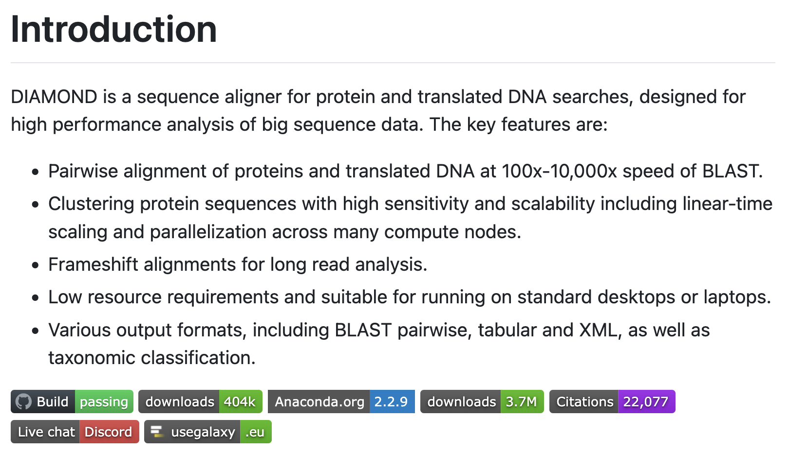
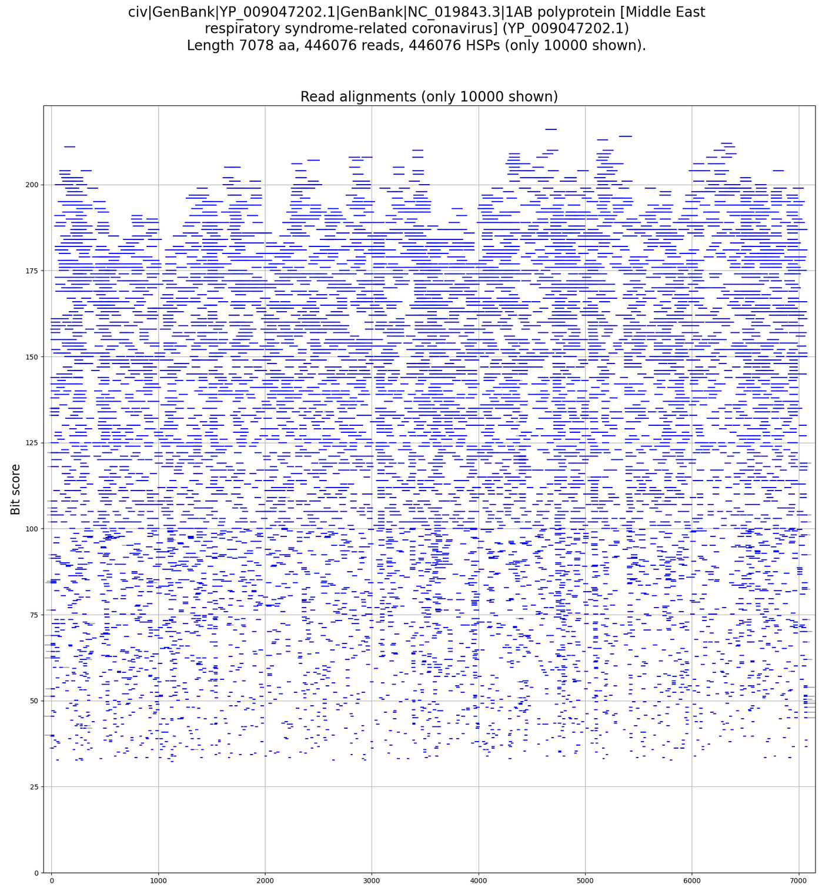
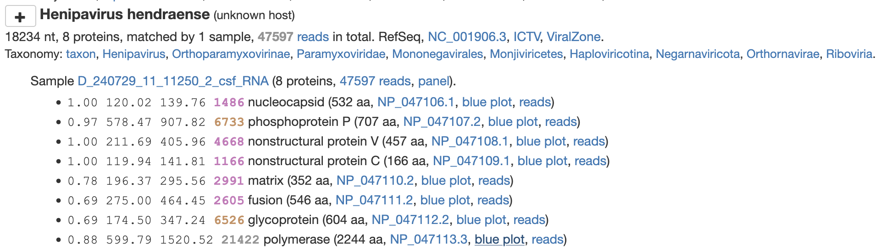
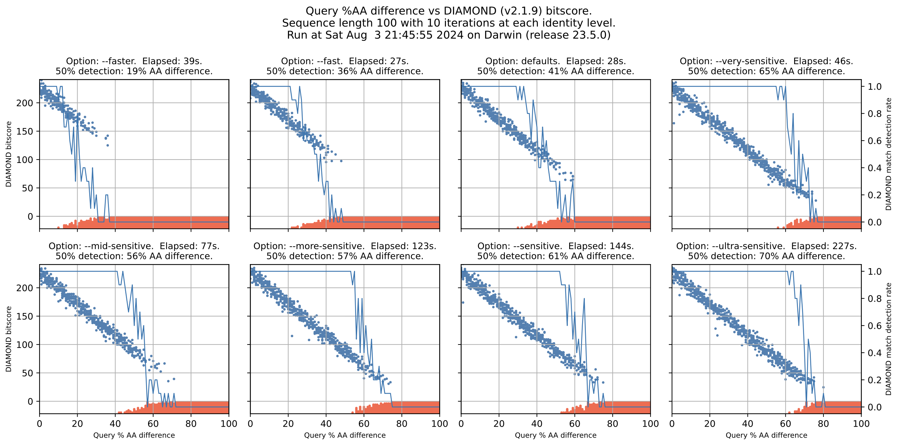

2026-11-20 class
===

Today we'll cover protein-level matching.

# How do we go about doing a protein match?

We sequence nucleotides, so we have nucleotide reference genomes and
nucleotide reads from sequencing.
Either or both of these can be translated to amino acid sequences.

# 2x2=4

That gives us four different high-level sequence-based ways we might
think about doing comparisons.

There are, of course, many packages
===

And today, of course, we'll mainly look at just one (DIAMOND).

# Nucleotide queries against a protein database

* Still around: BLASTX, DIAMOND, MMseqs2, Kaiju, LAST, MALT, Lambda.
* Older: PALADIN, RAPSearch2, PAUDA, GHOSTX/GHOSTZ, UBLAST.

# Protein queries against a protein subjects

* Exact dynamic programming: Needleman–Wunsch (global) and
Smith–Waterman (local): EMBOSS needle/water, and ssearch36 from the
FASTA package. Libraries: parasail (C, with Python and Rust bindings),
SWIPE, opal. Biopython’s PairwiseAligner is ok for small jobs.  GPU:
CUDASW++ 4.0.

* Heuristic database search (seed and extend): BLASTP, FASTA
DIAMOND blastp, MMseqs2, and USEARCH/UBLAST.

* Profile methods (more sensitive for remote homologues): PSI-BLAST,
DELTA-BLAST, HMMER 3, HHblits/HHsearch, MMseqs2.

# # Structural matching

* Foldseek

The traditional approach: Use BLAST
===

BLAST, dating from 1990, was for many years the standard tool used for
sequence alignments. See
https://en.wikipedia.org/wiki/BLAST_(biotechnology)

# BLAST shows the four high-level options

From the browser-based BLAST server at https://blast.ncbi.nlm.nih.gov/Blast.cgi


# The BLAST web service is very convenient

You can paste in a sequence and let the NCBI server do all the work
(URL above).  Scroll down and you'll see that that web page offers
a bunch of other alignment services.

# BLAST papers

Are among the most highly-cited papers in the whole of biology.
According to Google scholar, these two

* Altschul et al. (1990), "Basic local alignment search tool" J. Mol. Biol. 215:403–410
* Altschul et al. (1997), "Gapped BLAST and PSI-BLAST" Nucleic Acids Res. 25:3389–3402

have 128K and 92K citations, respectively.

BLAST is good, but has some serious shortcomings
===

* It's _very_ slow.
* It can't handle FASTQ (only uncompressed FASTA).
* The development process seems opaque. For years there was no repo,
  no way to submit bug reports or to send pull requests. You had to
  email them. Now there's https://github.com/ncbi/ncbi-cxx-toolkit-public
  but it's implausibly minimal.
  
Back in 2015 or so, BLAST was about 250K lines of code.

# In 2017 I found a terrible problem

Which they told me was a feature: https://terry.fluidinfo.com/2017/08/25/a-blast-puzzle/

This stems from a fundamental weakness (or you could say tradeoff) in the
seed and extend approach that's used by many programs. More on that later.

Today we'll use DIAMOND
===

But to use it you'll first need to download some protein sequences to
use as references.

We can use the `datasets` command we learned about in the 2026-10-02
CLUB club session on obtaining sequences. See 
https://www.ncbi.nlm.nih.gov/datasets/docs/v2/getting_started/

Install datasets, in case you didn't do it back in October:

```bash
$ pixi add ncbi-datasets-cli
```

# Get all Betacoronavirus proteins from RefSeq genomes

```bash
$ datasets download virus genome taxon Betacoronavirus --refseq \
    --include protein --filename cov-proteins.zip

$ ls -l
-rw-r--r-- 1 jonestc posix-nogroup 199273 Nov 19 21:00 cov-proteins.zip

$ unzip cov-proteins.zip

$ ls -l
-rw-r--r-- 1 jonestc posix-nogroup 199273 Nov 19 21:00 cov-proteins.zip
-rw------- 1 jonestc posix-nogroup    207 Nov 19 15:00 md5sum.txt
drwxr-xr-x 3 jonestc posix-nogroup     22 Nov 19 21:03 ncbi_dataset
-rw------- 1 jonestc posix-nogroup   1593 Nov 19 15:00 README.md
```

You'll find your data in `ncbi_dataset`.

What did we just download?
===

```bash
$ ls -l ncbi_dataset/data
total 656
-rw------- 1 jonestc posix-nogroup  44643 Nov 19 15:00 data_report.jsonl
-rw------- 1 jonestc posix-nogroup    309 Nov 19 15:00 dataset_catalog.json
-rw------- 1 jonestc posix-nogroup 536259 Nov 19 15:00 protein.faa

$ fasta-count.py ncbi_dataset/data/protein.faa
586

$ pixi add jq

$ jq .virus.organismName ncbi_dataset/data/data_report.jsonl
Bat coronavirus BM48-31/BGR/2008
Bat Hp-betacoronavirus/Zhejiang2013
Betacoronavirus England 1
Betacoronavirus Erinaceus/VMC/DEU/2012
Betacoronavirus HKU24
Bovine coronavirus
Human coronavirus HKU1
Human coronavirus OC43
Middle East respiratory syndrome-related coronavirus
Murine hepatitis virus
Murine hepatitis virus
Murine hepatitis virus strain JHM
Pipistrellus bat coronavirus HKU5
Rabbit coronavirus HKU14
Rat coronavirus Parker
Rousettus bat coronavirus
Rousettus bat coronavirus HKU9
SARS coronavirus Tor2
Severe acute respiratory syndrome coronavirus 2
Tylonycteris bat coronavirus HKU4
```

And you'll need some FASTQ
===

That you can match against the DIAMOND database.

There is some SARS-2 FASTQ in `~/data/fastq`. 

# And (bonus!) I have trimmed it for you:

```bash
$ fastp \
    -i ~/data/fastq/SARS2-R1.fastq.gz \
    -I ~/data/fastq/SARS2-R2.fastq.gz \
    -o ~/data/fastq/SARS2-R1-trimmed.fastq.gz \
    -O ~/data/fastq/SARS2-R2-trimmed.fastq.gz \
    -j /dev/null \
    -h /dev/null

# The following is trimmed for width.
$ ls -lh ~/data/fastq/SARS*
44M Nov 19 21:58 /home/jonestc/data/fastq/SARS2-R1.fastq.gz
42M Nov 19 22:49 /home/jonestc/data/fastq/SARS2-R1-trimmed.fastq.gz
51M Nov 19 21:59 /home/jonestc/data/fastq/SARS2-R2.fastq.gz
48M Nov 19 22:49 /home/jonestc/data/fastq/SARS2-R2-trimmed.fastq.gz

$ fasta-count.py ~/data/fastq/SARS2-R1.fastq.gz
306976
$ fasta-count.py ~/data/fastq/SARS2-R1-trimmed.fastq.gz
298120
```

DIAMOND
===

From https://github.com/bbuchfink/diamond/



# Install it

```bash
$ pixi add diamond
✔ Added diamond >=2.2.9,<3

$ diamond version
diamond version 2.2.9
```

Make a DIAMOND database
===

Using the Betacoronavirus protein sequences we downloaded above:

```bash
$ diamond makedb -d covdb --in ncbi_dataset/data/protein.faa
```

Running DIAMOND
===

DIAMOND only takes single FASTQ files (not pairs of them, like tools
such as `bowtie2` do).

So we could do this:

```bash
$ diamond blastx --quiet --outfmt 6 --db covdb \
    --query ~/data/fastq/SARS2-R1-trimmed.fastq.gz > diamond.out

$ diamond blastx --quiet --outfmt 6 --db covdb \
    --query ~/data/fastq/SARS2-R2-trimmed.fastq.gz >> diamond.out
```

That takes about 11 seconds

# Options

DIAMOND blastx has many command-line options. See
https://github.com/bbuchfink/diamond/wiki/3.-Command-line-options

# Output

But what will we find in `R1.out`?

`--outfmt` is useful. See `diamond blastx | less` for a ton of
options.

Note that the SAM output is not SAM!  Or at least it wasn't back in
2019 or so.

See https://github.com/bbuchfink/diamond/wiki/3.-Command-line-options#output-options

and there's more, at https://github.com/bbuchfink/diamond/wiki/File-formats

Blue plots
===

In our pipeline I process DIAMOND output format 6 into "blue plots"



Pranking Jules
===

I once put this into the pipeline output for Jules to find



MJSV
===

The Michael J. Scott virus!


DIAMOND sensitivity
===

DIAMOND has a bunch of sensitivity options, and their names can feel
like a bit of a mystery.  See
https://github.com/bbuchfink/diamond/wiki/3.-Command-line-options#sensitivity-modes
for some documentation.

I explored the sensitivity arguments back in 2016 and again in 2024. See
https://github.com/VirologyCharite/diamond-sensitivity



# What do we learn from all this?

* `--fast` and `--faster` are no faster (in fact sometimes
  both are slower) than DIAMOND's default.
* `--faster` fails to match much sooner (in terms of
  decreasing AA identity) than all other options.
* The default setting has a good tradeoff between speed and detection.
* To do better, the best next step is `--very-sensitive`,
    which does better detection and is much better than
    `--sensitive`, `--mid-sensitive`, and `--more-sensitive`.
* `--ultra-sensitive` has the best detection, but getting to detection
  at the 70% AA difference level takes about 5x as long as the 65% AA
  difference detection achieved by `--very-sensitive`.

DIAMOND sensitivity (plot only)
===


A DIAMOND data wrinkle
===

If you process paired-end FASTQ using DIAMOND, you'll run into
something that may which may cause a problem. Take a look at the query
IDs in the two files:

```bash
$ gunzip < ~/data/fastq/SARS2-R1-trimmed.fastq.gz | head -n 20 | egrep '^@'
@M01437:475:000000000-K3TP9:1:1101:17490:1692 1:N:0:GAATTCGT+GGCTCTGA
@M01437:475:000000000-K3TP9:1:1101:15998:1707 1:N:0:GAATTCGT+GGCTCTGA
@M01437:475:000000000-K3TP9:1:1101:19284:1711 1:N:0:GAATTCGT+GGCTCTGA
@M01437:475:000000000-K3TP9:1:1101:18017:1726 1:N:0:GAATTCGT+GGCTCTGA
@M01437:475:000000000-K3TP9:1:1101:13016:1732 1:N:0:GAATTCGT+GGCTCTGA

$ gunzip < ~/data/fastq/SARS2-R2-trimmed.fastq.gz | head -n 20 | egrep '^@'
@M01437:475:000000000-K3TP9:1:1101:17490:1692 2:N:0:GAATTCGT+GGCTCTGA
@M01437:475:000000000-K3TP9:1:1101:15998:1707 2:N:0:GAATTCGT+GGCTCTGA
@M01437:475:000000000-K3TP9:1:1101:19284:1711 2:N:0:GAATTCGT+GGCTCTGA
@M01437:475:000000000-K3TP9:1:1101:18017:1726 2:N:0:GAATTCGT+GGCTCTGA
@M01437:475:000000000-K3TP9:1:1101:13016:1732 2:N:0:GAATTCGT+GGCTCTGA
```

They are identical up to the space. And DIAMOND strips everything
after the first space. So if you combine output from the the `R1` and
`R2` files, you'll end up with duplicated read IDs.

Use `qtitle` with output format 6 to avoid this.

# Or change the read IDs with filter-fasta.py

This adds `-1` to the first part of the read IDs (and drops what's
after the space):

```bash
$ gunzip < ~/data/fastq/SARS2-R1-trimmed.fastq.gz | head -n 20 \
    | filter-fasta.py --idLambda 'lambda id: id.split()[0] + "-1"'
```

Understanding seed and extend
===

Frameshifts
===


<!--
Local Variables:
indent-tabs-mode: nil
End:
-->
